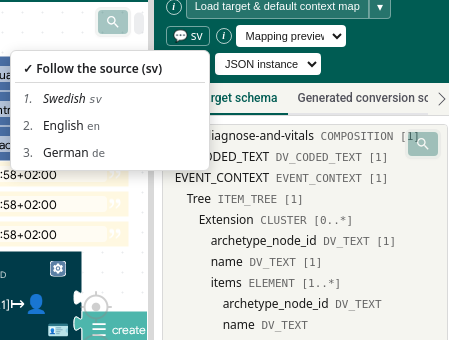

# Basic mapping

Map one source field onto one target slot. Nothing on this page repeats, and nothing is filled in by an AI. When you want those, continue with [Loops](loops.md) or [AI in the web app](ai-in-the-web-app.md).

Back to the [tutorial index](../TUTORIAL.md).

## Open the workbench

- **Web (recommended):** [regionstockholm.github.io/intehrgrator/recommended/](https://regionstockholm.github.io/intehrgrator/recommended/)
- **Web (latest / bleeding-edge):** [regionstockholm.github.io/intehrgrator/](https://regionstockholm.github.io/intehrgrator/)
- **Desktop:** download a build from [GitHub Releases](https://github.com/regionstockholm/intehrgrator/releases) and run the binary for your platform. The desktop app can also let an IDE agent work on the open canvas; see [Desktop and a local IDE](desktop-and-local-ai.md).
- **Pinned web versions:** [versions.json](https://regionstockholm.github.io/intehrgrator/versions.json) lists pinned URLs (`/v0.7/`, and so on).
- **VS Code extension:** download `intEHRgrator.vsix` from [GitHub Releases](https://github.com/regionstockholm/intehrgrator/releases) and install it with **Extensions: Install from VSIX…**. In VS Code a mapping is a **file project**: the schema, examples, mapping and generated output are ordinary files in your repository, so they can be reviewed in Git and checked in CI. Start with **intEHRgrator: Create File Project** or **intEHRgrator: Open File Project**; see [VS Code file projects](../VS_CODE.md).
- **Headless:** `intEHRgrator --headless` runs the workbench without a window, for IDE agents and automated runs.

All of these use the same Mapping Editors. The web and desktop apps keep projects in local storage and `.intehrgrator` files; VS Code keeps them as file projects. This page uses the web app; the steps are the same in the others.

Three panes: **Source** (left, slide-away), **Mapping Editors** (centre), **Target & Previews** (right, tabbed and slide-away). The Mapping Editors pane has the Blockly canvas on top and the **Mapping Spec**, **Tables & Sheets** and **Hints** tabs below. A large template opens in **Treemap Overview** instead of the canvas; see [Large templates](treemap.md).

Loading an Example Set is the fastest way to see a finished map. The steps below start from your own files. Click **ⓘ** beside a pane header when a format is unclear.

## Load source data

### Source schema (upper left)

Click **Load Schema** and pick a JSON Schema, an XSD, an XML sample, or an openEHR Web Template. You can also drop the file on the schema tree. The ▾ menu has **From file…**, **From GitHub template…**, **From URL…**, and **Refresh from file…** / **Refresh from URL…**, which update the schema without wiping your mappings.

An openEHR template can be the source too (the Obstetric MHV1 Example Sets map from an operational template). Its tree also shows the mandatory reference-model attributes the template leaves out, in muted italic. Optional RM attributes hide behind a small encircled plus on the row; open it to click-to-map one of them. A deprecated RM attribute (such as `hyperlink`) is struck through but still usable.

The schema tree shows field names and types, so you can author a mapping before you have an example file.

### Example instances (lower left)

Click **+ Add Example** and pick one or more JSON or XML instance files, or drop them on the example tree. The ▾ menu also has **From local folder…**, **From GitHub folder…** and **From URL…**. Each file gets its own tab.

- The **active tab** drives click-to-map and the matching **Test Run** on the right.
- Switch tabs to compare patients or edge cases.

## Load a target

In **Target & Previews**, click **Load target & default context map**. Pick a target (a schema or template file with **From file…**, a **Target URL**, or a minimal JSON, XML, or text example). Choose a **Default context map** now (for openEHR, the openEHR factory), or leave that to [Default context](default-context.md).

**Template scaffolding** decides how much is put on the canvas: **Full template (default)** scaffolds every path; **Sparse (mandatory only)** scaffolds only the mandatory ones, and you pull optional paths from the **Target schema** tab later. Sparse helps on very large templates.

**Load & scaffold** builds the **Template Skeleton**. The default context map option **New (empty)** loads the target into the **Target schema** tab only, so you can pull chips onto the canvas and then Apply.

Supported targets:

- openEHR operational template / Web Template (`.opt`, `.opt2`, `.wt.json`, `.adl`)
- JSON Schema
- XML Schema (XSD)
- Free-form text (no schema; Handlebars, decision-table snippets, and other text blocks)
- Minimal JSON, XML, or text example (no schema file; a conversion start sits above a small document)

An openEHR template becomes a **Template Skeleton**: nested Blockly blocks for the clinical model, including silent-mandatory RM fields the template file does not mention. In the **Target schema** tab, optional RM attributes sit behind the same encircled plus as in the source tree. An XSD or JSON Schema target becomes the same kind of skeleton, and its `enum` / `xs:enumeration` values become [value-set hints](value-set-hints.md).

The switch next to the **Mapping Editors** title chooses how the skeleton is shown: **Total Blockly ⏳** (the whole canvas, the default for small templates), **Treemap Overview**, or **Scoped Blockly** (one section). Templates with more than 400 blocks open in Treemap Overview. All three edit the same mapping; see [Large templates](treemap.md).

## Map one field (click-to-map)

Use this when the source value and the target slot are both single values, not lists.

1. Click a **value slot** on a Blockly block (or a row in the **Mapping Spec** tab).
2. The slot enters **listening mode** (highlighted).
3. Click a node in the **schema tree** or the **active example tree**.
4. A source-query block with the source path is inserted (`$.systolic` for JSON, an XPath for XML).

You can also drag a source node onto a slot. Yellow **constraint warning** triangles mark mandatory fields that are still empty.

*Click a magnitude slot (Systolic), then a node in the source tree. The slot stays in listening mode until that click.*

## When a slot has allowed values

A 💡 badge marks a **value-set hint**: the template (or an `enum` in a JSON Schema or XSD target) offers several codes, ordinals, text choices, or units. The slot stays empty until you map it. Click the badge or open **Hints** beside Mapping Spec and Tables & Sheets. Choose **Use as constant**, **Decision table: source → code**, or **Sheet lookup** to insert connected blocks; ★ marks an assumed value, not an applied default. Follow [Value-set hints](value-set-hints.md) for the steps.

## Try an Example Set

1. In the toolbar, open **Example Sets** and pick a row.
2. Confirm if the canvas already has work. Loading a set **replaces** the current source, target, and mapping.
3. Wait for the progress overlay to close. The target, Source Schema, mapping and grids are in, and you can already navigate and edit.
4. The **Example Instances** load last, with a spinner of their own in the examples pane (*Loading 4 example(s)…*). When they are in, the status bar says `Loaded example set "…"`.
5. Look at the left pane and the Mapping Editors.

- **Unmapped** rows leave Template Skeleton mouths empty (yellow triangles on mandatory slots).
- **Mapped** rows restore saved Blockly, and often Sheets and a default context map.
- Switch instance tabs, then look at **Conversion Test Run(s)**. How Test Run works is in [Tests and export](tests-and-export.md).
- The large sets (Obstetric MHV1 and partogram, Lung-MDT decision tables) open in **Treemap Overview**; see [Large templates](treemap.md).

Loading a set starts a fresh undo history for that project.

Catalog ids (`dummy-json-vitals`, `Simple-vitals`, …) stay stable for agents. The menu shows the **title**.

### Unmapped vs mapped

Most **families** (same source and target) have an unmapped and a mapped row. The obstetric sets that differ only in source format (Simplified FLAT, Canonical JSON) or target format (OPT2, Web Template) are unmapped only.

| Kind | What loads | Use it to |
|------|------------|-----------|
| **Unmapped** | Schema, instances, target only | Practise click-to-map on a blank skeleton |
| **Mapped** | The same files plus a saved mapping | Inspect a known-good canvas and run Test Run |
| **Mapped, decision tables** | Lung-MDT and chemo only | The same instances, with Notes and TermIds as decision tables. See [Sheets and decision tables](sheets-and-decision-tables.md) |

Titles put the family and route first and the mapping state last ([#166](https://github.com/regionstockholm/intehrgrator/issues/166)):

`{family} ({route}) — unmapped` · `{family} ({route}) — mapped` · `{family} ({route}) — mapped, decision tables`

| Family (route) | Unmapped | Mapped | Mapped, decision tables |
|----------------|----------|--------|-------------------------|
| Dummy vitals (JSON Schema → JSON Schema) | … — unmapped | … — mapped | — |
| Dummy vitals (JSON Schema → openEHR Template) | … — unmapped | … — mapped | — |
| Dummy vitals series (JSON Schema with repeating measurements → openEHR) | … — unmapped | … — mapped | — |
| OBX MHV1 (JSON → openEHR) | … — unmapped | … — mapped | — |
| Patient-reported chemotherapy symptoms (FLAT → TakeCare XML) | … — unmapped | … — mapped | … — mapped, decision tables |
| Lung MDT form (→ TakeCare XML) | … — unmapped | … — mapped | … — mapped, decision tables |
| Medication order data from Cytodos and TC via Karda (JSON → openEHR FLAT) | … — unmapped | … — mapped | — |
| Medication treatment data from Cytodos and TC via Karda (JSON → openEHR FLAT) | … — unmapped | … — mapped | — |
| Obstetric MHV1 generic entry (Simplified FLAT, operational template → Web Template) | … — unmapped | … — mapped | — |
| Obstetric MHV1 generic entry (Simplified FLAT, Web Template) | … — unmapped | … — mapped | — |
| Obstetric MHV1 generic entry (Simplified FLAT or Canonical JSON, OPT2 or Web Template) | … — unmapped | — | — |
| Obstetric partogram generic entry (Simplified FLAT or Canonical JSON; operational template, OPT2 or Web Template) | … — unmapped | — | — |

### Suggested first loads

1. **Dummy vitals (JSON Schema → JSON Schema) — unmapped** — click-to-map systolic, diastolic, and unit. Run Test on Mapping preview or TypeScript.
2. **Dummy vitals (JSON Schema → JSON Schema) — mapped** — three instances. Test Run should show `120` / `80` / `mm[Hg]` on `instance-1`.
3. A clinical **mapped** set: Dummy vitals → openEHR, or chemo or lung-MDT with **Mapping preview**, **Handlebars**, **TypeScript**, **XQuery** or **Go Template**. You pick these in the script dropdown in the **Target & Previews** header (it shows **Mapping preview** until you change it).

Named-invalid vitals instances (the filename contains `invalid` or `broken`) are negative tests. They should not produce a fully valid template instance.

The valid Simple-vitals and series instances show ✅ in **Mapping preview** and **TypeScript**. The clinical magnitudes `120` / `80` / `72` (series `138`) are present.

Chemo and lung-MDT **Mapping preview**, **Handlebars**, **TypeScript**, **XQuery** and **Go Template** produce the same TakeCare keywords, TermIds and Notes. **Java** cannot build these XML trees yet and says so instead of producing wrong output. Karda mapped sets emit Simplified FLAT; the medication treatment (administration) set shows ✅, and the open issues of each set are listed in [example-sets-audit.md](../agents/example-sets-audit.md). The OBX MHV1 mapped set maps only part of the source.

Lung-MDT Handlebars `@first` / `@last` is still open ([#135](https://github.com/regionstockholm/intehrgrator/issues/135)).

## Save your work

Mappings stay **on your computer**. The web app uses the browser’s storage. The desktop app uses the same kind of local storage. They are not uploaded, and they do not appear as ordinary files in your file explorer.

**Autosave** runs after a short pause (about 10 seconds). The status bar shows the time, for example “autosaved at 14:32”. Autosave and named saves survive closing the app and restarting the computer. Clearing site data removes them. Use **Export Project** for a file you can keep or move.

| Action | What it does |
|--------|--------------|
| **New Project** | Clear the workspace and start over (asks first) |
| **Autosave** | Snapshot after edits. Reopen with **Load Project** → Last autosave |
| **Save as** | Named snapshot in local storage |
| **Load Project** | Reopen a saved snapshot |
| **Export Project** | Download a `.intehrgrator` bundle |
| **Import Project** | Load a `.intehrgrator` file |

These commands are in the toolbar **File** menu. **Functions** has its own lecture. Each project has its own undo history: loading or importing another project, or **New Project**, starts a fresh one. **History** (the clock button next to Undo / Redo) lists the changes, who made them, and offers **Undo to here** and **Revert**.

## Help

- **ⓘ** next to pane headers explains formats.
- **Help** in the toolbar opens this tutorial series, **Report a bug**, and **Request a feature**. Describe the clinical workflow you are trying to support.
- The **UI** language picker at the top right switches the app and Blockly messages (English, Swedish, German, Spanish, Catalan, French). The 💬 button in the target pane is separate: it shows which language the target's labels are in. By default that is the first target language that matches the source's language (the Swedish labels for a Swedish source); pick another to keep it, or **Follow the source** to go back. Hover a target row to see its label in the other languages. A bilingual source schema (XSD `xml:lang`, JSON Schema `x-i18n`) gets its own 💬 in the Schema header for its descriptions. **AI ▾ → Languages…** sets the source languages when they cannot be detected, and which target languages' labels go to the AI. A language code that is not an ISO 639-1 code is listed as written, with ⚠.

  

- **Settings → Animations** sets the workbench animations (such as the Treemap zoom and breadcrumb effects) to **Always on (default)**, **Off**, or **Follow system**, which follows the operating system's reduce-motion setting; the menu shows whether that is on. **Reset to default** goes back to Always on. The choice is kept in this browser.

## Next

- [Default context](default-context.md) when the target needs language, facility, or other values that are not in the source file.
- [Optional RM fields](optional-rm.md) when the skeleton is missing a structure the Reference Model allows.
- [Tests and export](tests-and-export.md) when you want to see the produced instance.
- [Large templates](treemap.md) when the template is too big for one canvas.
