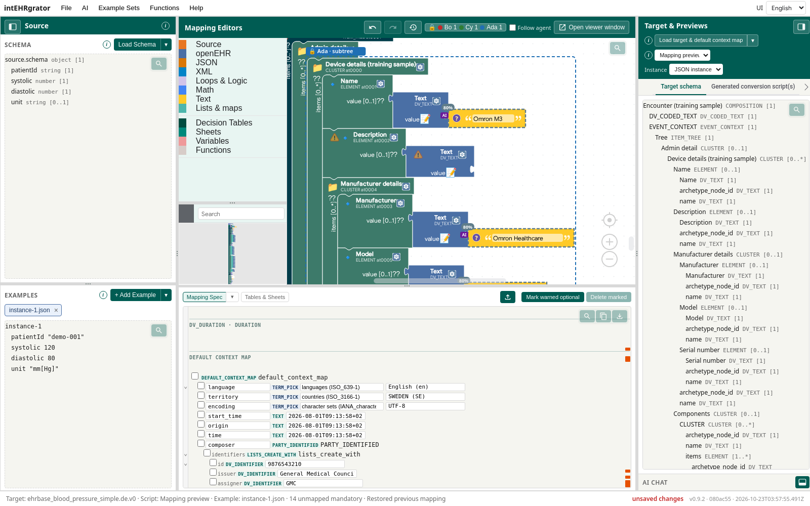
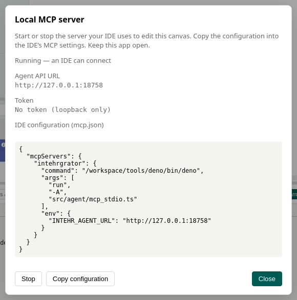
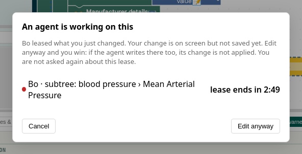
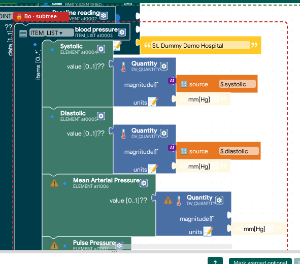
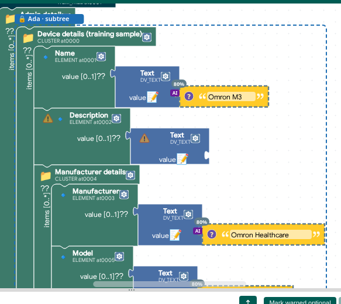
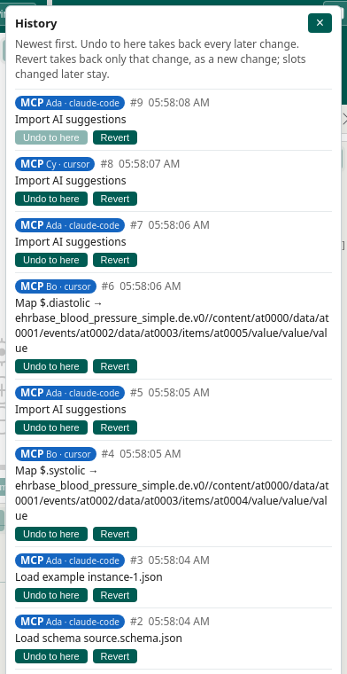

# Parallel IDE agents with leases

Two or three IDE agents can work on the same open canvas at once. Each one leases the part of the target it is working on. Another agent's write to that part is refused until the lease is released or runs out. The canvas shows who leases what.



Back to the [tutorial index](../TUTORIAL.md). Connecting one IDE to the desktop app is in [Desktop and a local IDE](desktop-and-local-ai.md). The full tool reference is [AGENT_WORKFLOW.md](../AGENT_WORKFLOW.md).

## Connect the agents

1. Start the desktop app and open **AI → Desktop → Local MCP server…**. Copy the configuration into the IDE, as in [Desktop and a local IDE](desktop-and-local-ai.md).

   

2. Open two or three agent chats. Each chat starts its own `intEHRgrator --mcp` process, and every process is a separate agent, even when they come from the same IDE.
3. Ask each agent to call `register_agent` with a short name first (for example Ada, Bo and Cy). An agent that does not register is named after its IDE (`cursor`, `cursor 2`) on its first change. Each agent gets its own colour.

## Split the work into leases

Give each agent its own part of the target, the way you would split work between people. Tell each one which part to take.

| Tool | What it does |
|------|--------------|
| `lease_slot { slotId }` | Lease one value slot |
| `lease_slot { slotId, subtree: true }` | Lease a node and every slot under it, for example one CLUSTER or one event |
| `list_leases` | Who holds what, and until when |
| `release_slot { slotId }`, `{ slotId, subtree: true }`, `{ all: true }` | Release one lease, a subtree lease, or everything the agent holds |

A lease lasts 120 seconds unless the agent asks for another `ttlSec` (at most an hour). Leasing again extends it. Leases are kept in the running app only. They are gone after a restart.

When an agent tries to change something that another agent leases, the whole call is refused and nothing changes. The agent gets a message it can act on:

```text
Subtree …/events/at0002/data/at0003 leased by Bo (agent-2) until 2026-10-23T06:00:06Z;
blocked slots: …/items/at0010/value/value; Work on other slots, or wait and retry.
```

The same rule covers **Undo**, **Redo** and **Revert** from an agent: an agent cannot take back another agent's leased change. `import_suggestions` is the exception. It skips the leased slots, applies the rest and lists what it skipped.

Leases hold back agents. The AI chat inside the app is never blocked, and neither are you, but you are asked first.

## When you edit inside a lease

If you change something an agent leases, for example by dragging a block into a leased part or by click-to-map, the app asks before saving the change. The warning names the agent and counts down to the end of the lease.



- **Edit anyway** saves your change. You are not asked again about that lease until it ends. If the agent then writes to that slot, its change is not applied and the status line says so: you win. The agent is told to read the slot again.
- **Cancel** takes your change back. Nothing is saved.
- If the lease ends or the agent releases it while the warning is open, the warning closes and your change is saved.

You are asked when a change is about to be saved: at the end of a drag, a field edit or a click. Typing in a field does not ask on every key.

## See who leases what

The **Mapping Editors** header shows one chip per agent, with its colour and the number of leases it holds. Hover over it for the list. Click it to jump to the next leased block.


On the canvas, a leased block gets a dashed frame in the agent's colour and a 🔒 tag with its name. A subtree lease has a thicker frame and the tag says **subtree**. If the leased node has no block of its own, the nearest block above it is marked.





The markers only show the current state. They are not saved with the project and do not appear in History.

## Follow up in History

**History** names each agent and its IDE, for example **MCP Bo · cursor**. **Undo to here** and **Revert** work as usual for you ([ADR 0014](../adr/0014-one-write-path-attributed-undo.md)).



## Try it without an IDE

The repository has a demo that plays three agents against a running app:

```bash
deno run -A src/desktop/main.ts --headless --port 8765 &
deno run -A scripts/parallel_agents_demo.ts --url http://127.0.0.1:8765 --load --hold 60 --step 1
```

- **Ada** leases the device details and fills in text values.
- **Bo** leases the blood pressure reading and maps systolic and diastolic.
- **Cy** tries to comment in Bo's subtree (refused), maps the tilt in its own subtree, and tries an undo that would take back Bo's change (refused).

Add `--bin path/to/intEHRgrator` to run each agent as a real `intEHRgrator --mcp` process instead of from source. `scripts/tutorial_parallel_agents_screenshots.ts` takes the screenshots on this page.

## Compared with pen.dev

[pen.dev](https://pen.dev) runs up to six agents on one design canvas. Each agent shows a named cursor, and you split the work between them. Here the agents run in your IDE. The lease is the explicit "this part is mine": agents cannot overwrite each other, and you can always step in.
