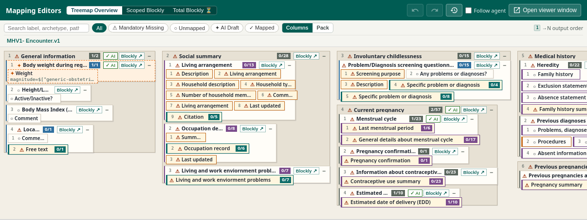
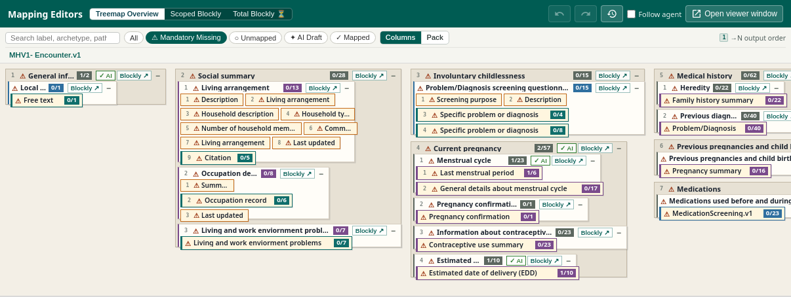
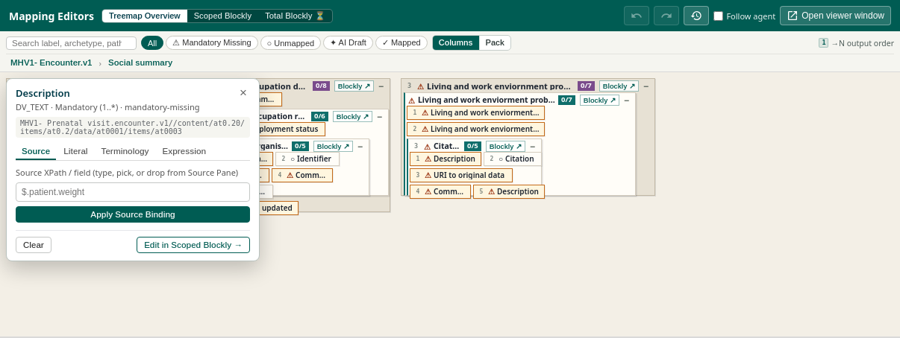
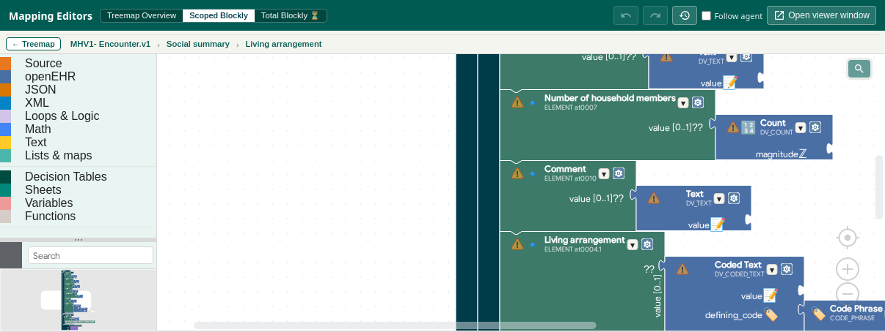

# Large templates: Treemap Overview and Scoped Blockly

A large template (MHV1 prenatal visit, the TakeCare Lung MDT form) has hundreds of blocks. Drawing all of them on the Blockly canvas takes seconds and is hard to read. **Treemap Overview** shows the whole template as nested tiles instead, with what is mapped and what is missing. You map simple leaves right there, and open one section at a time in **Scoped Blockly** for real logic.

Back to the [tutorial index](../TUTORIAL.md). Assumes [Basic mapping](basic-mapping.md).

## Switch between the three views

The switch next to the **Mapping Editors** title has three views of the same mapping:

| View | What it shows |
|------|---------------|
| **Treemap Overview** | The whole target as tiles. Opens by itself when the template has more than 400 blocks. |
| **Scoped Blockly** | Ordinary Blockly for one section (an ENTRY, CLUSTER or container) of the template. Edits are written back into the whole mapping. |
| **Total Blockly ⏳** | The whole template on one Blockly canvas. The default for small templates; on a large one it can take several seconds. |

All three edit the same mapping. Undo, the Mapping Spec, Test Run and autosave do not depend on the view. Small templates open in **Total Blockly**, and you can still switch to **Treemap Overview** for a summary.

Try it with the Example Set **Obstetric MHV1 generic entry (Simplified FLAT, Web Template) — mapped**. It opens in Treemap Overview.

## Read the tiles

- A **container tile** (SECTION, ENTRY, CLUSTER, or an XML/JSON element with children) has a header: its order number, a status glyph, the label, a **done/total** count of its leaves, **Blockly ↗**, and **−** to collapse it to a small blob.
- A **leaf tile** is one value slot (an ELEMENT, or a field of an XML or JSON target).
- The colour of the left edge follows the reference-model type. The glyph is the mapping status: **○** unmapped, **⚠** mandatory and still missing, **✦** an AI draft, **✓** mapped, **✕** a validation error, and **+** an optional node that is not scaffolded (Sparse mode, below).
- The small numbers (1, 2, 3…) are the order in which siblings are written to the output, the same top-to-bottom order as Blockly. Hover a number to highlight its siblings.
- Hover any tile to see a one-line summary in the status bar, such as `Height/Length (OBSERVATION) · #2/4 · ○ Unmapped · Optional`.

## Find what to map

- **Search** (*Search label, archetype, path…*) keeps the tiles whose label, archetype or path matches, and their parents.
- The **filter chips** keep tiles by status: **All**, **⚠ Mandatory Missing**, **○ Unmapped**, **✦ AI Draft** and **✓ Mapped**. **⚠ Mandatory Missing** is the to-do list for a valid instance.
- **Columns** (the default) lists the outermost tiles top to bottom in columns, in output order; scroll sideways for more. **Pack** fills the available space instead, which shows more at once but loses the reading order.

## Zoom in and out

Click a container header to zoom into it. The breadcrumb under the controls shows where you are (`MHV1- Encounter.v1 › Social summary`); click a part of it to go back up. **−** collapses a container in place; click the blob to open it again.

## Map a leaf in place

Click a leaf tile. An inline editor opens next to it, and the Mapping Spec scrolls to the same slot. It has four mapping options:

| Tab | What it writes |
|-----|----------------|
| **Source** | A source query. Type a path (`$.patient.weight`, an XPath), pick a field from the list, or drag a node from the Source pane onto the field. **Apply Source Binding**. |
| **Literal** | A constant of the slot's data type (text, number, date, boolean). **Apply Literal**. |
| **Terminology** | A coded value: code system, code and display term. **Apply Terminology Binding**. |
| **Expression** | One small, checkable expression: **Trim whitespace**, **Unit scale / offset**, **Fallback default**, or **Join two fields**. **Apply Expression**. |

**Clear** removes the mapping on that slot. **Edit in Scoped Blockly →** opens the slot's section in Blockly. When the slot already holds logic that these tabs cannot show (a loop, a decision table, a Function call), the editor warns **Complex Blockly logic** and does not replace it unless you tick **Allow replacing complex logic from inline editor**. Usually you want Scoped Blockly instead.

Every apply is one Undo step, the same as an edit on the canvas.

## AI drafts

Mappings that an AI chat or an IDE agent wrote, and that nobody has looked at yet, are **✦ AI drafts**. The inline editor of a draft leaf has **✓ Accept** and **✕ Reject**. A container with drafts has **✓ AI** in its header, which accepts every draft in that section. Use the **✦ AI Draft** chip to review them one by one.

## Open a section in Scoped Blockly

Click **Blockly ↗** on a container, or double-click a tile. That exact container opens in **Scoped Blockly**: the ordinary toolbox and canvas, with only that part of the template. Loops, Include when, decision tables and Functions are edited here, as in the other lectures.

The breadcrumb above the canvas starts with **← Treemap**. Click it, or **Treemap Overview** in the switch, to go back; your edits are kept.

## Sparse templates

**Load target & default context map** offers **Template scaffolding**: **Full template (default)** puts every path on the canvas, **Sparse (mandatory only)** only the mandatory ones. In Treemap Overview the optional paths of a sparse template show as faint **+** tiles. Clicking one tells you to add it from the **Target schema** tab: drag it onto the canvas, as in [Optional RM fields](optional-rm.md).
