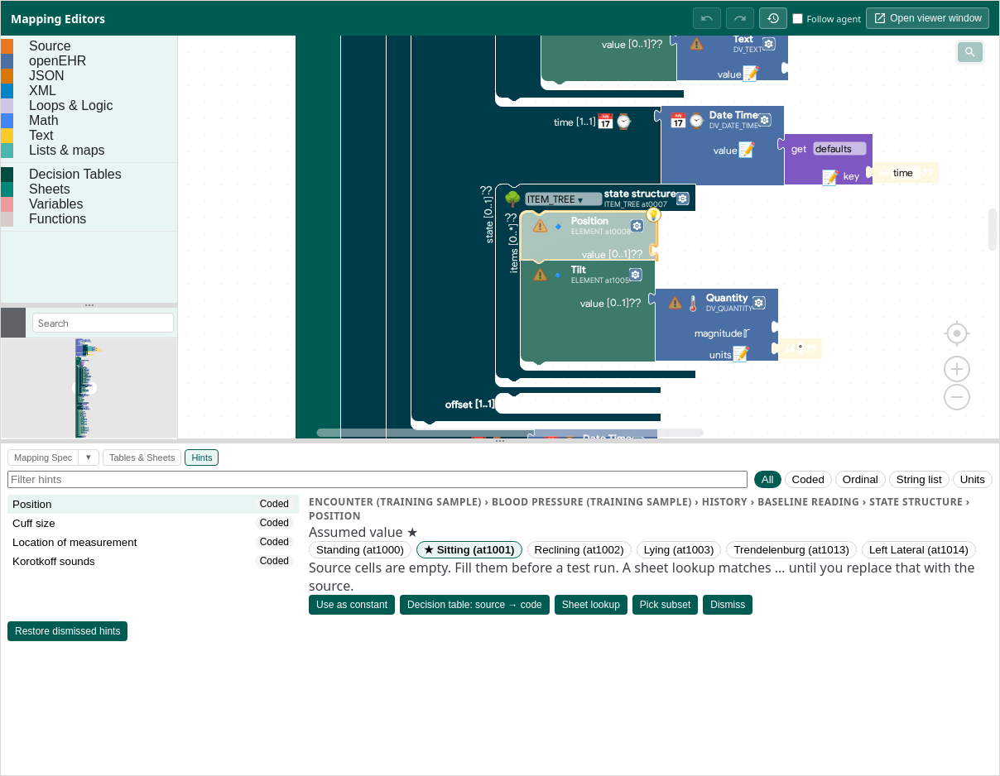
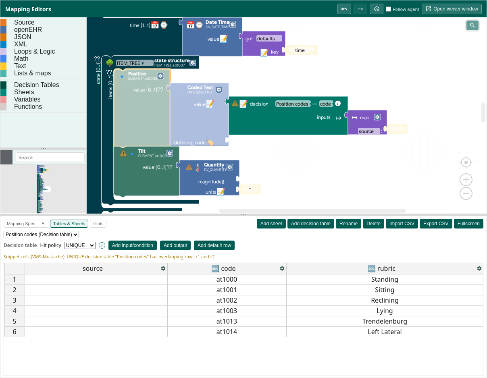

# Value-set hints

Turn a template's allowed values into a mapping without copying its code list by hand.

Back to the [tutorial index](../TUTORIAL.md).

## Find the hint

Load an **unmapped** openEHR Example Set, such as Dummy vitals → openEHR. **Position** has several allowed codes. Its value socket is empty: no code is emitted just because it is first in the list.

The **Hints 💡 count** chip counts active, non-dismissed hints. A yellow dashed outline surrounds each helped block and its contained blocks until the hint is applied or dismissed.

Click the **💡 badge** on the canvas, or open **Hints** next to **Mapping Spec** and **Tables & Sheets**, then select the slot. Use the search or kind filters for **Coded**, **Ordinal**, **String list**, or **Units**. Selecting a hint brings its canvas block into view.

*The ★ is the template's assumed value. It is a suggestion, not an applied default or a conversion result.*

## Choose how to map it

| Action | What appears on the canvas |
|--------|----------------------------|
| **Use as constant** | The selected value connected to the target. Built-in RM/openEHR terminology choices use a **term pick** (`term_pick`) dropdown; local codes use the ordinary coded-value Function with the text, code, and terminology. Ordinals keep their value and symbol; string choices become text. |
| **Decision table: source → code** | A connected **decision** block reading a new named table, with an **inputs** map whose `source` entry you bind to the source data. |
| **Sheet lookup** | A connected **lookup** block reading a new named sheet, with `source` as the match column (coded values return the whole row). Replace the `…` match-value placeholder with your source expression. |

For a constant, click the chip you want, then **Use as constant**. For a built-in term pick, the resulting dropdown remains editable. A **Units** hint connects its chosen constant or grid reader to the quantity's **units** socket; it does not replace the magnitude expression. Mapping only the units does not supply a missing magnitude.

To restrict a grid to fewer targets, select only those chips before choosing the grid action. Chip selection limits what that action uses; it does not change the hint itself.

Coded and ordinal grid actions insert the ordinary library Function **`coded_value_from_row`** into the slot root. It consumes **one row Map** (decision table **all outputs**, or a whole-row sheet lookup) and returns the complete coded text, code phrase, or ordinal with its coded symbol. The grid keeps code, rubric, and terminology together; you wire the source **once**, not separately for `value` and `defining_code`. The Function is editable like any contributed Function — no special generator block. Existing `coded_text_from_sheet` remains useful for column-configurable sheet lookups and equivalent term mappings.

## Complete a grid mapping

The action creates **both** the grid and its connected reader blocks. The **source** column is deliberately blank: the template tells us the allowed targets, not which source values mean each one.

*The warning is expected here: the source conditions are not filled yet. The reader is already connected to Position.*

1. Bind the reader's source input: the **inputs → source** map entry for a decision table, or the **match value** for a sheet lookup. Use the source expression for the relevant code, text, or unit.
2. Fill the **source** cells with reviewed source values. For example, a source value `sitting` might map to target `at1001` / `Sitting`; confirm that meaning rather than matching similar words blindly. Keep the target code, rubric, terminology, ordinal value, or unit columns intact.
3. For a decision table, fill every retained row's condition or delete unused rows. A blank condition means **don't care**, not “never match”. Hint-created tables start with **UNIQUE**, so overlapping blank rows fail rather than silently selecting the first code. Keep UNIQUE unless your intended rule logic needs another [hit policy](sheets-and-decision-tables.md#hit-policy).
4. **Run Test** on the active example, then on the other examples and missing/unmatched source values. Check both the code and its text, or the magnitude and its units. See [Tests and export](tests-and-export.md).

A sheet lookup starts with `…` so it cannot accidentally match the initially blank source cells. It is a placeholder, not a source query.

### Optional AI help

After creating either kind of grid, the UI offers to insert a prompt for filling the blank source column.

- **Not now** keeps the grid and connected blocks; fill them manually.
- **Insert prompt** puts the request in **AI chat**. It does **not** send it or start a model call. Review it before sending or copying it to an external chat.
- The prompt uses the loaded **Source Schema** and **Active Example** and asks to preserve the target choices. Review the proposed source matches and the resulting decision-table warnings before running a conversion.

This offer is only in the interactive UI. Agent/MCP `list_slots` exposes the hint and `apply_hint` applies the same actions, but does not offer or run an AI prompt. See [AI in the web app](ai-in-the-web-app.md#fill-a-hint-created-grid).

## Dismiss, restore, undo

**Dismiss** hides the active hint; it does not fill the slot or make missing mandatory data valid. **Restore dismissed hints** brings it back. Dismissals belong to the project and are forgotten when that slot's allowed choices change.

An applied constant or grid mapping replaces the hint. One **Undo** restores the canvas, grid, and hint settings together; **Redo** reapplies them.
